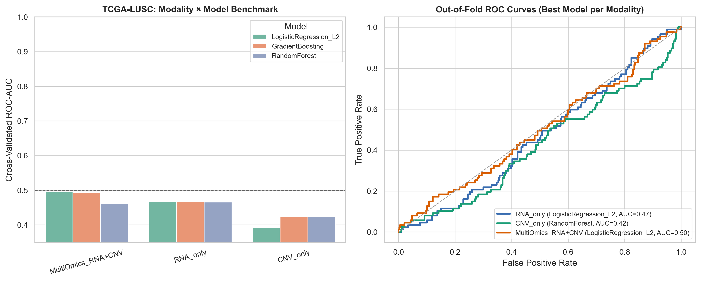
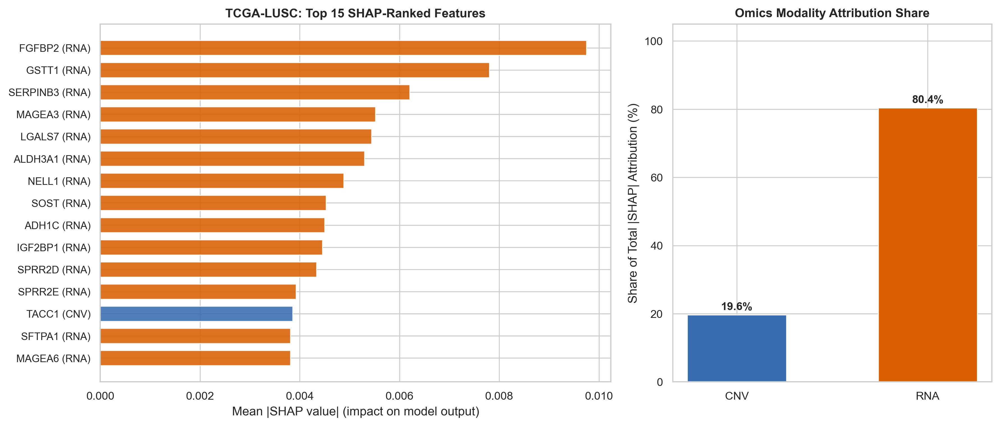

# multiomics-cancer-biomarker-ml

[](https://github.com/arjunbioinfo/multiomics-cancer-biomarker-ml/actions/workflows/ci.yml)
[](LICENSE)

A reproducible, config-driven **Snakemake + Python** workflow for benchmarking whether **TCGA RNA-seq expression**, **GISTIC2 gene-level copy number variation (CNV)**, or both together predict a clinical outcome. It uses leak-free cross-validated classification (`scikit-learn`), **SHAP** feature attribution, and out-of-fold penalized **Cox / Kaplan–Meier** survival scoring (`lifelines`).

Every push runs offline unit tests and executes the full Snakemake pipeline on real public **TCGA-LUSC** (Lung Squamous Cell Carcinoma) multi-omics data from **UCSC Xena** in GitHub Actions CI.

## Result on TCGA-LUSC: no predictive signal

On the CI profile (471 primary tumours, 467 with complete data), the task is to separate advanced (stage III–IV, n = 87) from early (stage I–II, n = 380) lung squamous cell carcinoma. **No modality or model does better than chance.**

| Modality | Best model | ROC-AUC | PR-AUC (baseline 0.19) |
| --- | --- | ---: | ---: |
| RNA + CNV | Logistic regression (L2) | 0.50 | 0.21 |
| RNA only | Gradient boosting | 0.47 | 0.19 |
| CNV only | Random forest | 0.42 | 0.17 |

The out-of-fold Cox model on the ten top-ranked features is also uninformative: Harrell's C-index is 0.50, the median-split log-rank p-value is 0.16, and no feature reaches p < 0.05.

**How to read this.** Because feature selection and scaling happen inside each training fold, these estimates are not inflated by information leaking from the test samples. On this cohort and target, bulk expression and gene-level copy number do not separate early from advanced stage. The SHAP rankings and Cox hazard ratios therefore describe a model with no predictive value; they are not candidate biomarkers. The workflow is useful as a leak-free benchmarking template: point it at another TCGA cohort or another outcome and it reports honestly whether a signal exists.




## Pipeline Overview

1. **Multi-Omics Download & Alignment (`download_multiomics.py`)**: Fetches `TCGA-LUSC` log2-normalized RNA-seq (`HiSeqV2`), GISTIC2 gene-level CNV (`Gistic2_CopyNumber_Gistic2_all_data_by_genes`), overall survival (`LUSC_survival.txt`), and clinical stage metadata (`LUSC_clinicalMatrix`) from UCSC Xena ([UCSC Xena, TCGA-LUSC cohort](https://xenabrowser.net/datapages/?cohort=TCGA%20Lung%20Squamous%20Cell%20Carcinoma%20(LUSC))), filters to primary tumors (`-01`) with `OS.time >= 30` days, intersects patients across both modalities, and logs exact provenance in `data/raw/download_manifest.json`.
2. **Leak-Free Cross-Validated Benchmarking (`train_and_explain.py`)**: Runs stratified 5-fold cross-validation with strictly inside-fold variance selection and scaling (`scikit-learn` `Pipeline`), comparing `RNA_only`, `CNV_only`, and `MultiOmics_RNA+CNV` across L2 Logistic Regression, Random Forest, and Gradient Boosting (`ROC-AUC`, `PR-AUC`, `Balanced Accuracy`, `Brier Score`).
3. **SHAP Feature Attribution (`train_and_explain.py`)**: Computes exact `shap.TreeExplainer` attributions on the multi-omics tree model, ranking top `RNA` and `CNV` features and quantifying each modality's total attribution share. Attributions are only meaningful when the model itself predicts better than chance.
4. **Out-of-Fold Survival Modeling (`train_and_explain.py`)**: Fits L2-penalized `lifelines.CoxPHFitter` on the top SHAP-ranked multi-omics features using cross-validated out-of-fold risk scores (Harrell's C-index, median-split Kaplan–Meier log-rank test, and multivariate hazard ratios).
5. **Visualization (`plot_summary.py`)**: Produces four 300 DPI summary figures in `figures/`.

## Quick Start

```bash
# 1. Create environment (Conda)
conda env create -f environment.yml
conda activate multiomics-biomarker-ml

# ...or pip:
pip install -r requirements.txt

# 2. Run offline unit tests
make test

# 3. Fast end-to-end run on real TCGA-LUSC multi-omics data (CI profile)
make ci

# 4. Full feature run
make run

# Or run via Docker
docker build -t multiomics-biomarker-ml .
docker run --rm -v "$(pwd)/results:/app/results" -v "$(pwd)/figures:/app/figures" multiomics-biomarker-ml
```

## Outputs

* `results/cv_benchmark_metrics.tsv` — Stratified CV `ROC-AUC`, `PR-AUC`, balanced accuracy, and Brier score across all 3 modalities × 3 models.
* `results/oof_predictions.tsv` — Out-of-fold predicted probabilities per patient, modality, and model.
* `results/shap_biomarker_importance.tsv` — Ranked features with mean `|SHAP|` and modality attribution share (%). Interpret only alongside the benchmark metrics.
* `results/survival_oof_scores.tsv` — Out-of-fold Cox risk scores, High/Low risk assignments, Harrell's C-index, and log-rank p-value.
* `results/survival_cox_biomarkers.tsv` — Multivariate penalized Cox hazard ratios (95% CI, p-values) for the top SHAP-ranked features.
* `figures/` — `modality_model_benchmark.png`, `shap_biomarkers_summary.png`, `survival_risk_stratification.png`, and `cox_hazard_forest.png`.

## Adapting to Another TCGA Cohort

Change `cohort.name` and the four dataset paths in `config/config.yaml` (e.g., `TCGA.CESC`, `TCGA.LUAD`, or `TCGA.BRCA`) and re-run `make run`.

## Repository Layout

* `Snakefile` — End-to-end Snakemake workflow
* `Makefile` — `setup`, `test`, `ci`, `run`, and `clean` shortcuts
* `config/config.yaml` / `config/ci.yaml` — Full and fast CI TCGA-LUSC configurations
* `workflow/scripts/` — Modular Python scripts (`download_multiomics.py`, `train_and_explain.py`, `plot_summary.py`)
* `notebooks/walkthrough.ipynb` — Interactive exploration notebook
* `tests/test_pipeline.py` — Offline synthetic 80-patient unit + smoke tests
* `environment.yml`, `requirements.txt`, `Dockerfile`, `.dockerignore`, `CITATION.cff`
* `.github/workflows/ci.yml` — GitHub Actions CI (pytest + real TCGA-LUSC multi-omics run)

## License

MIT — see [LICENSE](LICENSE).

## Author

**Mallikarjuna Thippana, PhD** — Computational Biologist, Karolinska Institutet  
[Portfolio](https://arjunbioinfo.github.io/) · [ORCID](https://orcid.org/0000-0001-8485-8626) · [Google Scholar](https://scholar.google.com/citations?user=NpLUj68AAAAJ) · [GitHub](https://github.com/arjunbioinfo)
